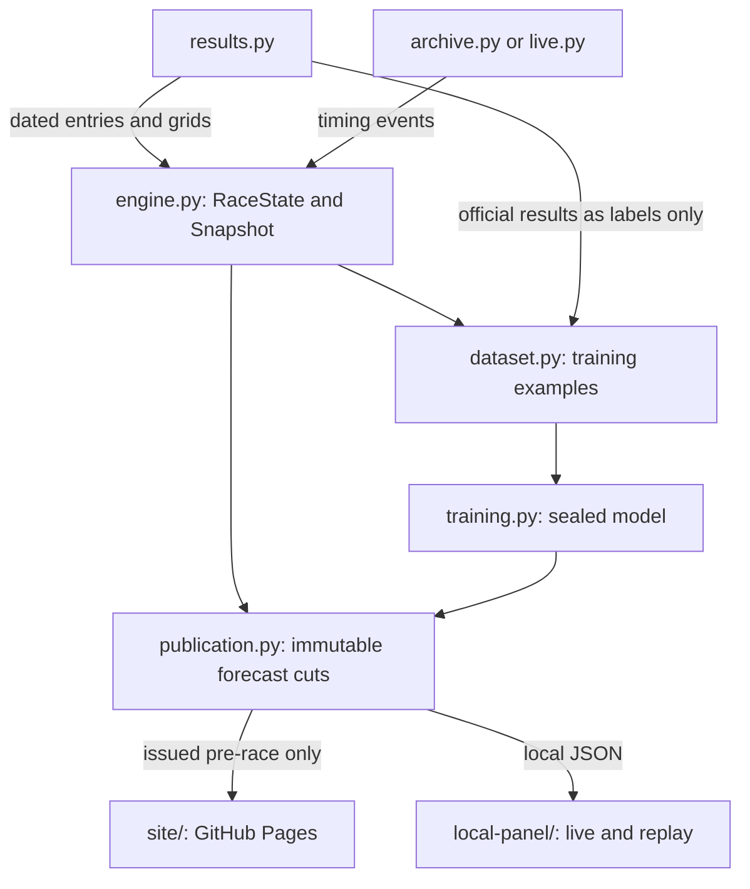

# Repository Guidelines

## Project Overview

Podio probable forecasts the official ordered podium of the main Formula 1 Grand Prix. It makes predictions before FP1, 30 minutes before the scheduled race start, and after each observed leader lap. The Spanish dashboard distinguishes live forecasts from historical replays.

## Architecture & Data Flow



`probability.py` enumerates ordered triples of distinct drivers. Mix Plackett–Luce distributions **before** deriving position probabilities. Display the most probable joint triple, not the three drivers with the highest individual podium probabilities.

## Key Directories

- `f1forecast/` owns ingestion, training and forecasts. `site/data/upcoming.json` is the only feed on GitHub Pages. `local-panel/` holds the loopback dashboard and a derived São Paulo replay.
- `reports/` holds derived evaluation and leakage evidence. Keep raw timing, classifications, datasets and model bundles in ignored `.local/`, outside Git and the public site.

## Delivery

Verify each project change, commit it, then push every commit to GitHub `origin` before reporting completion. Preserve existing history and report any push failure.

## Development Commands

Run from the repository root:

```sh
uv sync --locked --python 3.12
uv run --locked python -m f1forecast --help
uv run --locked python -m f1forecast panel --port 8070
uv run --locked python -m http.server 8071 --bind 127.0.0.1 --directory site
```

Open `http://127.0.0.1:8070/` and select **Repetición** to check the shipped replay without model weights. Port 8071 previews the public site.

For a fresh model run, start with `uv run --locked python -m f1forecast --work .local/repro prepare`. Keep the same prefix and run `train`, `prepare --period final`, then `evaluate`. Put `--work` **before** each subcommand. Preparation downloads source data; evaluation verifies the sealed model without refitting.

For Rustuna use `train --trials 8` in a separate work directory with training data only. Keep the released bundle and 2026 final reports unchanged unless a new selection is justified without using the final period.

## Code Conventions & Common Patterns

- Python uses four spaces and `snake_case`. Use `YYYY-RR` calendar rounds and uppercase driver codes. Pass history into `RaceState` and the model bundle into prediction functions explicitly.
- `RaceState.apply()` rejects invalid or decreasing UTC timestamps. Apply all events sharing a timestamp before emitting a lap snapshot. Use receipt time for live cuts; archive clocks do not prove live latency. Preserve `FEATURES` order: sealed learners select columns by index.
- Freeze each `(horizon, lap)` once. `publication.append_cut()` rejects duplicates; `publication.write_file()` replaces JSON atomically. Reconstructed cuts have `origin: backtest` and `published_utc: null`.
- SignalR callbacks use a locked queue. Browser code uses two spaces, `camelCase`, `async`/`await` and a shared `view` object. Keep UI text in Spanish.

## Important Files

- [PROTOCOL.md](PROTOCOL.md) freezes the split: 2022 warm-up, 2023 internal calibration, 2024–25 model selection by GP-weighted podium Brier score. Never tune on 2026 rounds 1–20. Unversioned labels have a 14-day embargo and never become features.
- [README.md](README.md) covers released weights, replay and live operation. [AUDIT.md](AUDIT.md) records upstream evidence and limitations, not tests for this checkout.
- `f1forecast/__main__.py` defines CLI arguments and guards access to final data. The separate `f1forecast.gain_study` module reads `.local/validation-data.joblib`, regardless of `--work`.

## Runtime/Tooling Preferences

Use Python 3.12 and uv with `pyproject.toml` and `uv.lock`. The project is not installed as a package. Plotly.js is vendored; no Node runtime, build step or CDN. `f1forecast.pages` checks the Pages artifact before upload. `watch` and `replay` cannot write under `site/`.

## Testing & QA

Run `python -m f1forecast.pages` for the public artifact and `uv run --locked python -m unittest discover -s tests` for the Rustuna chronological split test. After preparing final data in the work directory above, run:

```sh
uv run --locked python -m f1forecast --work .local/repro leakage --gp 2026-20
```

Removing or poisoning future data must leave entrants and lap identical at all three horizons. Features and joint probabilities must match with `atol=1e-12`, `rtol=0`. At publication, each position sums to one across drivers; each driver's podium probability is the sum of their three position probabilities.
